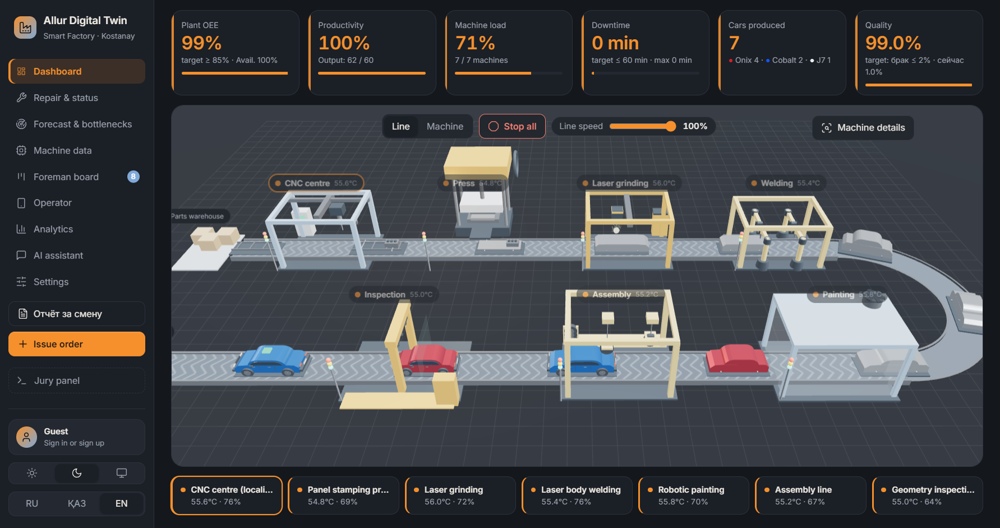
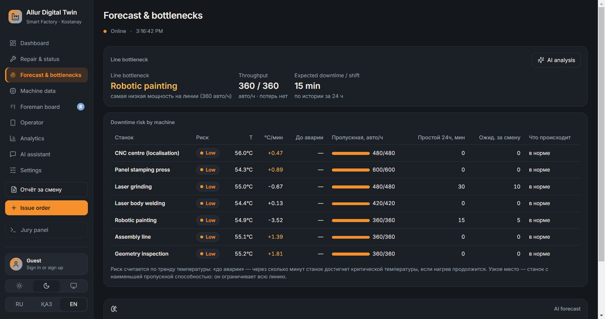

# Allur Digital Twin

**A digital twin of an automotive assembly plant, built in a weekend for the Qostanai Industry Hackathon (2026).**

The case: help the Allur car plant in Kostanay see its production line in real time, catch problems before they stop the line, and report to managers without spreadsheets. We built a web app that models the line in 3D, tracks KPIs live, predicts downtime and lets an AI agent answer questions and take actions.

> Team project. Original repository: [Aldiar-bsd/hakaton_project](https://github.com/Aldiar-bsd/hakaton_project).



## Features
- **3D production line** (three.js) — 7 machines with live status, temperature, vibration, load and output, updated every 1.5 s over WebSocket.
- **KPI dashboard** — OEE (availability × performance × quality), defect rate, downtime, monthly output vs. targets (OEE ≥ 85%, defects ≤ 2%, downtime ≤ 60 min/day, ≥ 5,500 cars/month).
- **Incidents and downtime forecast** — temperature-trend prediction ("failure in N minutes"), bottleneck detection, effect estimate (e.g. 30% less downtime).
- **AI agent** with tools: reads the line state, changes speed, stops machines, creates rules and work orders, simulates failures. Works with Google Gemini, Anthropic Claude or a local Ollama model — and falls back to an offline mode without any API key.
- **Work orders** — created from the plant document, automatically after incidents, or by hand; master panel and worker view with timers.
- **Reports** in PDF, Excel and Word; import of the plant's own `.docx` data file.
- **Telegram bot** for reports and alerts (included, disabled by default).
- 19 color palettes, light and dark themes, tuned to run on an ordinary office PC.



## Architecture
```
Machine simulator  ──▶  FastAPI server (Python)  ◀──WebSocket / REST──▶  Browser client
(OPC UA / MQTT slot)      sim · db (SQLite) · importer · orders          3D line · dashboard · forecast
Plant .docx file   ──▶    agent / ai · offline · reports · bot           master panel · AI chat · settings
                          ▲
                          └── Gemini / Claude / Ollama · Telegram Bot API
```
The simulator can be replaced with real OPC UA / MQTT data without changing the rest of the code. More details (data sources, formulas, security) are in [ARCHITECTURE.md](ARCHITECTURE.md) (in Russian).

## Tech
- **Backend:** Python 3.10–3.12, FastAPI, Uvicorn (REST + WebSocket), SQLite, httpx.
- **Reports:** ReportLab (PDF), openpyxl (Excel), python-docx (Word and input parsing).
- **Frontend:** plain HTML/CSS/JavaScript without a build step, three.js (3D), Chart.js (charts), Lucide icons.
- **AI:** tool-calling agent; questions are answered in one request, commands go through tools.

## Run it
1. Install Python 3.10–3.12.
2. Copy `.env.example` to `.env` and, optionally, add an AI key (`AI_PROVIDER` = `gemini` / `anthropic` / `ollama` / `none`).
3. Run `start.bat` (Windows) or `./start.sh` (macOS/Linux). The first run installs the dependencies, then the site opens at http://localhost:8000.

Without an AI key the app runs in offline/demo mode. The browser needs internet access for the CDN libraries (three.js, Chart.js, fonts). Keys live only in `.env` / `API_KEY.txt`, which are git-ignored; the UI shows only the last 4 characters.

## Team
Built by our team at the Qostanai Industry Hackathon, including [@Aldiar-bsd](https://github.com/Aldiar-bsd) and [@ZemBono](https://github.com/ZemBono).
